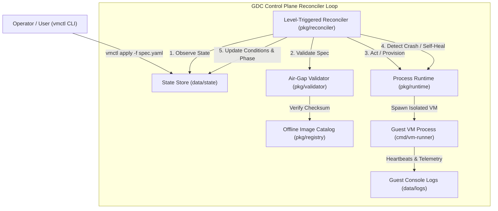

# GDC Air-Gapped Virtual Machine Operator (`gdc-vm-operator`)

[](https://github.com/uday68/gdc-vm-operator/actions)
[](https://golang.org)
[]()
[]()
[]()
[]()

A lightweight, production-grade **Air-Gapped Virtual Machine Lifecycle Operator and CLI in Go**, designed to mirror the architectural paradigms of **Google Distributed Cloud (GDC) Virtual Machine Infrastructure**.

---

## 1. Problem Statement & Architecture

In mission-critical, high-security sectors (defense, government intelligence, critical national infrastructure, and sovereign banking), computing hardware must operate in strictly disconnected **air-gapped environments** with zero external network connectivity.

Traditional cloud virtualization engines rely on internet access to pull machine images, verify licenses, and download dependencies. `gdc-vm-operator` solves this through:

1. **Declarative State Management:** Spec vs. Status separation following Kubernetes Custom Resource Definition (CRD) standards.
2. **Air-Gap Security Admission Validation:** Prohibits outbound URI fetching and enforces SHA-256 cryptographic integrity against an offline local artifact registry.
3. **Continuous Reconciliation & Self-Healing:** A level-triggered control loop that detects process termination and restores desired state with configurable backoff thresholds.
4. **Cross-Platform Host Telemetry:** Native process lifecycle management via POSIX signals (`Signal(0)`) and Win32 APIs (`STILL_ACTIVE`).



---

## 2. Project Layout

Following standard Kubernetes and Go project conventions:

```
gdc-vm-operator/
├── api/
│   └── v1alpha1/           # Kubernetes CRD schemas (Spec, Status, Conditions)
├── cmd/
│   ├── vmctl/              # Operator CLI tool (init, apply, get, describe, logs)
│   └── vm-runner/          # Isolated guest hypervisor runner simulation
├── pkg/
│   ├── registry/           # Air-gapped offline image repository & SHA-256 verifier
│   ├── validator/          # Admission validation engine & security policy guards
│   ├── store/              # Atomic state persistence & crash-recovery store
│   ├── runtime/            # Cross-platform process supervisor & health telemetry
│   └── reconciler/         # Level-triggered state reconciliation control loop
├── examples/               # Declarative YAML manifests (valid & air-gap violation)
├── docs/
│   └── INTERVIEW_STUDY_GUIDE.md  # Complete system design & interview guide
└── bin/                    # Compiled native binaries
```

---

## 3. Quickstart Guide

### Step 1: Build the Binaries
```bash
go build -o bin/vm-runner.exe ./cmd/vm-runner
go build -o bin/vmctl.exe ./cmd/vmctl
```

### Step 2: Initialize Air-Gapped Environment
Bootstrap the local offline repository and seed verified image artifacts:
```bash
.\bin\vmctl.exe init
```
*Output:*
```
[INIT] Initializing air-gapped environment directories...
[INIT] Air-gapped registry seeded with 2 offline images:
       - ubuntu-22.04 (SHA256: 459a16578b74c4501c5abae1d3fc5ba66d0aafc0b29b01298628be29596d56cb)
       - cirros-0.5.2
[INIT] Sample manifests written to examples/valid-ubuntu-vm.yaml and examples/airgap-violation.yaml
[SUCCESS] Environment ready!
```

### Step 3: Inspect Registered Offline Images
```bash
.\bin\vmctl.exe images
```

### Step 4: Apply Declarative VM Manifests
```bash
# Submit a valid air-gapped VM
.\bin\vmctl.exe apply -f examples/valid-ubuntu-vm.yaml

# Submit a VM attempting unauthorized external network fetching
.\bin\vmctl.exe apply -f examples/airgap-violation.yaml
```

### Step 5: Start the Continuous Reconciliation Loop
```bash
# Run daemon control loop
.\bin\vmctl.exe run

# Or execute a single reconciliation cycle
.\bin\vmctl.exe run --once
```

### Step 6: Monitor Cluster State & Self-Healing
```bash
# List all VMs
.\bin\vmctl.exe get vms

# Detailed telemetry & condition inspection
.\bin\vmctl.exe describe database-primary

# Inspect VM guest console logs
.\bin\vmctl.exe logs database-primary
```

---

## 4. Test Suite & Verification

The codebase features comprehensive unit tests, table-driven tests, and end-to-end reconciliation tests:

```bash
go test -v ./...
```

*Test Coverage Highlights:*
* **Table-driven validation:** Verifies valid specs, negative resource handling, DNS compliance, and air-gap URL interceptors.
* **Integrity verification:** Simulates bit-flip / hash tampering to guarantee tampered disk images fail pre-flight admission.
* **Crash recovery:** Tests state reconstruction from disk manifests across operator reboots.
* **Self-healing:** Programmatically kills VM processes to verify automatic fault detection, PID reassignment, and restart tracking.

---

## 5. System Design & Interview Reference

For deep-dive technical explanations, memory efficiency patterns (`io.Copy`), concurrency considerations (`sync.RWMutex`), and exact Google interview talking points, consult the [Interview Study Guide](docs/INTERVIEW_STUDY_GUIDE.md).

