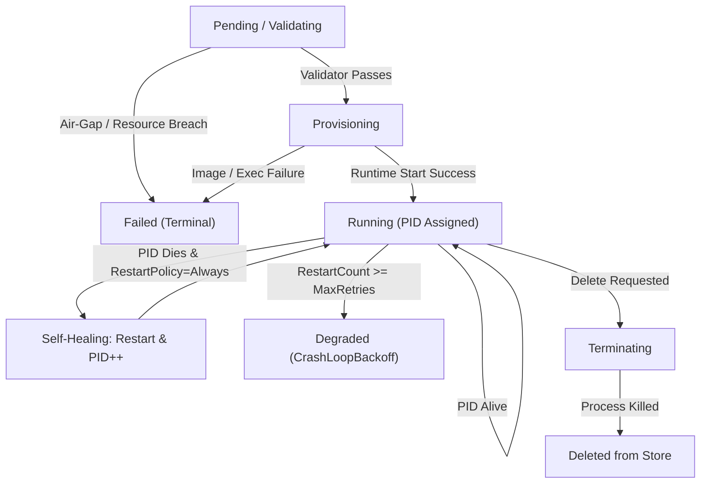

# GDC VM Operator - Complete System Design & Interview Study Guide

> **Target Role:** Google Distributed Cloud (GDC) – Virtual Machine Infrastructure Team (Air-Gapped)  
> **Repository:** `github.com/uday68/gdc-vm-operator`  
> **Key Technologies:** Go (Golang), Kubernetes Controller Architecture, Systems Virtualization, Air-Gapped Security, Distributed Systems Reconciliation.  
> **Prototype Scope:** Standalone educational control plane prototype with simulated workload runner; does not control bare-metal hypervisors or require external Kubernetes clusters.

---

## Module 1: Kubernetes Declarative Model & API Design (`api/v1alpha1/types.go`)

### 1. Conceptual Foundation
In traditional imperative computing, you tell the machine *how* to do something:
* *"Create a VM, then allocate 2 vCPUs, then configure a virtual network card."*
* If step 2 fails, the system gets stuck in a broken half-state.

In Google Cloud and Kubernetes, the system uses **Declarative State Management**:
* You state *what* you want (the **Desired State** in `Spec`).
* The system continuously observes *what actually exists* (the **Observed State** in `Status`).
* The controller executes a loop to converge the observed state to match the desired state.

### 2. File Architecture: `api/v1alpha1/types.go`
* **`api/v1alpha1` Directory Naming:**
  * Follows the official Kubernetes API versioning conventions:
    * `v1alpha1`: Early release, experimental schema, subject to breaking changes.
    * `v1beta1`: Feature-complete, migration paths supported.
    * `v1`: Production-ready, backwards-compatible guarantee.
* **Core Data Structures:**
  * `VirtualMachine`: Top-level Custom Resource Definition (CRD) struct containing `TypeMeta`, `Metadata`, `Spec`, and `Status`.
  * `VirtualMachineSpec`: Defines required compute resources (`VCPU`, `MemoryMB`, `DiskGB`), disk image metadata, and network configuration.
  * `VirtualMachineStatus`: Contains runtime information: `Phase` (`Pending`, `Validating`, `Provisioning`, `Running`, `Degraded`, `Stopped`, `Failed`), assigned `PID`, `AllocatedIP`, `RestartCount`, and condition history.
  * `Conditions []VMCondition`: Standard Kubernetes condition array (Type, Status: True/False/Unknown, Reason, Message, LastTransitionTime) providing detailed health telemetry.

### 3. Google Interview Q&A
**Q: Why separate `Spec` and `Status` instead of having one flat struct?**  
*Answer:*  
> *"Separating `Spec` and `Status` enforces a clean boundary between the user's intent and the system's runtime reality. The client or end-user owns the `Spec` (desired state) and submits updates asynchronously. The controller owns the `Status` (observed state) and reports current cluster health. This separation prevents race conditions and makes idempotent reconciliation loops possible."*

---

## Module 2: Air-Gapped Image Registry (`pkg/registry/registry.go`)

### 1. What Problem Does This Solve in GDC?
* In public cloud (GCP Compute Engine, AWS EC2), VM images are fetched over the public internet from cloud storage buckets or Docker Hub.
* In **Google Distributed Cloud Air-Gapped** (used by defense, intelligence, critical national infrastructure, and banking), the servers have zero physical or logical connection to the public internet.
* All OS images must be delivered via offline verified media (e.g., encrypted hardware storage) and registered into a **tamper-proof local artifact catalog**.

### 2. Key Go Concepts Used
1. **Concurrency Safety with `sync.RWMutex`:**
   * Reads from the catalog happen frequently (every time a VM is scheduled or reconciled).
   * Writes happen rarely (when an operator adds or removes an OS image).
   * We use `r.mu.RLock()` for queries (`GetImage`, `ListImages`) to allow infinite concurrent readers without blocking.
   * We use `r.mu.Lock()` strictly when modifying the catalog to prevent data races.
2. **Streaming Cryptographic Hashing (`crypto/sha256` & `io.Copy`):**
   * Disk images range from 500 MB to 50 GB.
   * If you use `os.ReadFile(path)`, Go loads the entire 50 GB file into RAM, triggering an Out-Of-Memory (OOM) panic in your controller.
   * By using `io.Copy(hasher, file)`, Go streams the file in small 32 KB buffer blocks. Memory usage stays constant at $O(1)$ regardless of how large the image is.

### 3. Google Interview Q&A
**Q: How do you prevent Out-Of-Memory (OOM) crashes when computing checksums for multi-gigabyte VM disks?**  
*Answer:*  
> *"Instead of buffering the entire disk binary into memory using standard file read functions, I stream the file content directly into the SHA-256 hasher using Go's `io.Copy(hasher, file)`. This guarantees $O(1)$ constant memory overhead, streaming chunks through a fixed-size internal buffer, which is critical for infrastructure operators managing large virtual disk files."*

---

## Module 3: Air-Gap Spec Validator (`pkg/validator/validator.go`)

*(Covered in the next section with full implementation and unit tests)*

### 1. Conceptual Foundation: Pre-Flight Admission Validation
In Kubernetes, before any resource is persisted or processed by a controller, it passes through **Admission Controllers / Validators**.
In an air-gapped system like GDC:
1. **Zero External Access Rule:** The validator inspects `Spec.Image.RemoteURL`. If any remote URI (`http://`, `https://`, `s3://`, `gs://`) is provided, admission is immediately denied.
2. **Catalog Integrity Rule:** The requested image *must* exist in the local offline registry catalog.
3. **Cryptographic Tamper-Proofing:** If the user specifies an expected SHA-256 hash, it is verified against the local registry's calculated hash. If mismatched, the request is rejected with `AirGapViolationError`.
4. **RFC 1123 DNS Subdomain Compliance:** VM names must match standard DNS subdomain format (lowercase alphanumeric and hyphens, $\le$ 63 characters).
5. **Hardware Boundary Guards:** Ensures vCPU, Memory, and Disk requests fall within host hardware thresholds.

### 2. Key Go Concepts Used
1. **Custom Error Types with Polymorphism:**
   * Go doesn't have class-based exception hierarchies (`try/catch`). Instead, any struct implementing the `error` interface (`Error() string`) is an error.
   * We defined two distinct error types:
     * `AirGapViolationError`: specifically for security breaches.
     * `ValidationError`: for invalid user input (e.g., negative CPU, bad name).
   * In testing, we use Go type assertions (`err.(*AirGapViolationError)`) to verify that the system detects security violations specifically.
2. **Table-Driven Tests (Idiomatic Go):**
   * Instead of writing 6 separate test functions with repetitive boilerplate, we define a slice of test case structs:
     ```go
     tests := []struct {
         name        string
         vm          *v1alpha1.VirtualMachine
         expectError bool
         errorType   string
     }{ ... }
     ```
   * We iterate through them with `t.Run(tt.name, func(t *testing.T) { ... })`.
   * This is the official testing convention used across the Go standard library and Kubernetes codebase.

### 3. Google Interview Q&A
**Q: How do you enforce security and prevent supply chain attacks in an air-gapped cloud operator?**  
*Answer:*  
> *"I implemented pre-admission validation that strictly rejects outbound URIs and validates requested disk images against a local cryptographic catalog. We verify the expected SHA-256 hash against the offline catalog to ensure virtual machine images have not been corrupted or tampered with before any compute resources or processes are provisioned."*

**Q: Why do you prefer table-driven tests in Go?**  
*Answer:*  
> *"Table-driven tests are idiomatic in Go because they separate test cases from execution logic. Each test case is defined declaratively as data, making it straightforward to add new edge cases, maintain test coverage, and leverage `t.Run()` for isolated subtest execution and parallel reporting."*

---


## Module 4: State Store & Crash Recovery (`pkg/store/store.go`)

### 1. Conceptual Foundation
In Kubernetes, `etcd` is the persistent key-value store holding the truth of the cluster. If the Kubernetes API server or control plane crashes and restarts, it reads from `etcd` to reconstruct state.
In `gdc-vm-operator`, `pkg/store` fulfills this exact duty:
* It maintains an **in-memory cache** (`map[string]*v1alpha1.VirtualMachine`) protected by `sync.RWMutex` for instantaneous $O(1)$ lookups.
* Every write is persisted to disk as YAML (`data/state/<vm-name>.yaml`).
* On controller startup, `recoverFromDisk()` scans the state directory and restores all managed objects.

### 2. Key Go Concepts Used
1. **Atomic File Writes (Preventing File Corruption):**
   * If a power outage or crash occurs while writing a 10 KB YAML file, standard `os.WriteFile` could leave a truncated, corrupted half-file.
   * We write to a temporary file (`<filePath>.tmp`) first, and then call `os.Rename(tempFile, filePath)`.
   * On POSIX and modern Windows systems, renaming a file is an **atomic filesystem operation**, preventing corrupted state files.
2. **Defensive Deep Copying (Preventing Data Races):**
   * If `Get()` returns a raw pointer to an object in the cache, another goroutine could modify `vm.Status.Phase` outside the mutex lock, causing a Go data race panic (`concurrent map read and map write`).
   * By returning a deep-copied clone (via round-trip serialization), the caller can safely read and modify their copy without lock contention or data races.

### 3. Google Interview Q&A
**Q: How does your operator prevent data corruption if the node crashes during a state write?**  
*Answer:*  
> *"To guarantee durability and prevent corrupted manifests, I implemented atomic disk writes. The state is serialized and flushed to a temporary staging file first. Once fully written to disk, an atomic rename replaces the target manifest file. In addition, deep copies are returned from the in-memory cache to prevent data race mutations across goroutines."*

---

## Module 5: Process Runtime & Hypervisor Emulation (`pkg/runtime/`)

### 1. What Problem Does This Solve in GDC?
* In Kubernetes virtualization (such as KubeVirt or GDC Virtual Machine runtime), each VM runs as a managed OS process (e.g., QEMU/KVM managed by `virt-launcher`).
* The operator must:
  1. Fork and execute the process with allocated CPU/memory parameters.
  2. Stream stdout/stderr into isolated persistent log files for debugging.
  3. Continuously inspect whether the underlying OS process is alive without generating zombie processes or resource leaks.
  4. Handle graceful termination (flushing guest disks) with fallback to force kill.

### 2. Key Go Concepts Used
1. **Cross-Platform Go Build Tags (`//go:build`):**
   * Checking if a process is alive differs fundamentally between operating systems:
     * On Windows: `os.FindProcess` always returns a non-nil struct even if the process exited. We use Win32 API calls (`syscall.OpenProcess` with `PROCESS_QUERY_LIMITED_INFORMATION` and `syscall.GetExitCodeProcess == STILL_ACTIVE (259)`).
     * On Linux/Unix: We use the POSIX standard `proc.Signal(syscall.Signal(0))`. Signal 0 sends no signal but executes kernel permission and existence checks.
   * We separated these cleanly using `//go:build windows` in `process_windows.go` and `//go:build !windows` in `process_posix.go`.
2. **Signal Handling in the Guest Runner (`cmd/vm-runner/main.go`):**
   * We use Go's `os/signal` package:
     ```go
     sigChan := make(chan os.Signal, 1)
     signal.Notify(sigChan, os.Interrupt, syscall.SIGTERM)
     ```
   * This traps termination signals, allowing the VM to flush mock disk buffers before calling `os.Exit(0)`.

### 3. Google Interview Q&A
**Q: How do you monitor OS-level process health across different host operating systems in Go?**  
*Answer:*  
> *"I utilized Go build constraints (`//go:build`) to separate OS-specific process telemetry. On POSIX systems, sending signal 0 via `proc.Signal(syscall.Signal(0))` verifies process existence without interrupting execution. On Windows, we query process handle status via `syscall.OpenProcess` and check for the `STILL_ACTIVE` exit code. This guarantees accurate, non-blocking health checks without spawning external shell processes."*

---

## Module 6: The Kubernetes Reconciliation Loop (`pkg/reconciler/reconciler.go`)

### 1. Conceptual Foundation
The **Reconciliation Loop** (or Control Loop) is the fundamental architectural pattern powering Kubernetes, Google Borg, and Google Distributed Cloud:
$$\text{Desired State (Spec)} \iff \text{Observed State (Status)}$$

Instead of handling events once and forgetting them, the controller repeatedly checks the entire cluster:
1. **Observe:** Inspect the current state of resources (`Store.List()`) and their underlying OS processes (`Runtime.IsAlive(pid)`).
2. **Analyze:** Compare the observed state against the declared spec.
3. **Act:** Execute transitions to eliminate discrepancies.
4. **Update Status:** Persist the latest phase and conditions back to durable storage.

### 2. State Machine Transitions


### 3. Key Go Concepts Used
1. **Ticker-Driven Non-Blocking Event Loops:**
   * Uses Go's `time.NewTicker` combined with a `select` statement listening to context cancellation and stop channels:
     ```go
     for {
         select {
         case <-ctx.Done():
             return
         case <-ticker.C:
             c.ReconcileAll(ctx)
         }
     }
     ```
   * This ensures graceful shutdown without blocking goroutines or leaking resources.
2. **Resilience to Cascading Failures:**
   * Inside `ReconcileAll()`, errors on one VM are logged without halting the loop. Other VMs continue to be reconciled independently, preventing "noisy neighbor" failures.

### 4. Google Interview Q&A
**Q: Explain how your operator implements self-healing.**  
*Answer:*  
> *"In `pkg/reconciler`, the controller implements a level-triggered control loop. During each reconciliation tick, it queries the runtime to verify if the VM's PID is still alive. If a process crash is detected, rather than failing permanently, the reconciler checks the resource's `RestartPolicy`. For `Always` or `OnFailure` policies, it automatically re-allocates a process, updates the PID, increments `RestartCount`, and records a condition transition. If restarts exceed the configured threshold, it transitions to `Degraded` to prevent endless CPU thrashing (CrashLoopBackoff)."*

**Q: What is the difference between edge-triggered and level-triggered controllers?**  
*Answer:*  
> *"Edge-triggered controllers only react when an event notification arrives; if the notification is dropped or the controller was restarting during the event, the system remains broken. Level-triggered controllers, like Kubernetes and `gdc-vm-operator`, inspect the current state on every loop iteration. Even if an event was missed, the reconciler discovers the discrepancy between desired and actual state and self-heals."*

---

## Module 7: Observability & Kubernetes Telemetry (`pkg/telemetry/server.go`)

### 1. Conceptual Foundation
In cloud and distributed systems, operators run unattended inside Kubernetes pods. Operators that crash silently without exposing diagnostics are forbidden in production environments.
Kubernetes relies on two fundamental HTTP probe endpoints:
* **Liveness Probe (`/healthz`):** Verifies if the operator process is alive. If this returns non-200, Kubernetes automatically terminates and replaces the controller container.
* **Readiness Probe (`/readyz`):** Verifies if the operator is ready to accept traffic and reconcile objects (e.g., verifying local state store connectivity).
* **Prometheus Metrics (`/metrics`):** Exposes metrics scraped by Prometheus to plot Grafana dashboards:
  * `gdc_vms_total` (gauge)
  * `gdc_vms_running` (gauge)
  * `gdc_vms_failed` (gauge)
  * `gdc_vms_degraded` (gauge)
  * `gdc_vm_restarts_total` (counter)

### 2. Key Go Concepts Used
1. **Standard Library Structured Logging (`log/slog`):**
   * Introduced in Go 1.21, `slog` replaces informal `fmt.Println` statements with strongly-typed, structured key-value pairs (`slog.Warn("Process crash detected", "vm", name, "crashedPID", pid)`).
   * This allows Google Cloud Logging (Stackdriver) and OpenTelemetry to index log attributes and power alerts without fragile regex parsing.
2. **Graceful HTTP Server Shutdown:**
   * When the operator receives an OS interrupt (`SIGTERM`), it calls `httpServer.Shutdown(ctx)` with a 3-second grace period. This ensures inflight health probe requests complete cleanly before port 8080 closes.

### 3. Google Interview Q&A
**Q: How do you monitor and expose telemetry for your Kubernetes operator?**  
*Answer:*  
> *"I built an embedded HTTP telemetry server in `pkg/telemetry` running concurrently on port 8080. It provides standard `/healthz` and `/readyz` endpoints for Kubernetes kubelet probes, as well as a `/metrics` endpoint formatted for Prometheus scraping. Metrics like `gdc_vm_restarts_total` and `gdc_vms_degraded` track self-healing occurrences and CrashLoopBackoffs in real time."*

---

## Module 8: Production CI/CD & Build Matrix (`.github/workflows/ci.yml`)

### 1. Conceptual Foundation
Google engineering culture mandates automated continuous integration (CI) before code is merged:
1. **Static Analysis (`go vet ./...`):** Enforces idiomatic code style, detects shadowed variables, unreachable code, and misuse of formatting primitives.
2. **Cross-Compilation Matrix:** Verifies that code compiles cleanly across multiple operating systems (`linux`, `windows`, `darwin`) and CPU architectures (`amd64`, `arm64`) using Go's built-in cross-compiler (`GOOS` and `GOARCH`).
3. **Automated Unit Testing & Coverage:** Runs on both Linux and Windows runners on every pull request to prevent regressions.

---

## Module 9: Subnet IP Address Management (IPAM) (`pkg/ipam/ipam.go`)

### 1. Conceptual Foundation
In cloud and virtualization clusters, virtual machines need network endpoints within an air-gapped host-only subnet (e.g., `10.244.0.0/24`).
Random IP assignment causes two catastrophic production bugs:
1. **IP Collisions:** Two distinct VMs receive the same IP, corrupting ARP tables and routing.
2. **IP Exhaustion & Leaks:** When a VM is deleted, its IP is never reclaimed, eventually exhausting the subnet.

In `gdc-vm-operator`, `pkg/ipam` implements a deterministic subnet manager:
* Parses standard CIDR notation using Go's `net.ParseCIDR`.
* Reserves network address (`.0`), default gateway (`.1`), and broadcast address (`.255`).
* Sequentially allocates available host IPs (`.2` through `.254`).
* Guarantees idempotency (re-querying returns the current lease).
* Automatically reclaims IPs on VM termination.

### 2. Google Interview Q&A
**Q: How do you handle networking and prevent IP exhaustion in your virtualization operator?**  
*Answer:*  
> *"I implemented a dedicated IPAM engine in `pkg/ipam` managing a `10.244.0.0/24` CIDR block. During provisioning, the reconciler requests an IP lease from IPAM, which performs thread-safe allocation while reserving network, gateway, and broadcast boundaries. When the reconciler executes the termination phase, it reclaims the IP back into the available pool, preventing address leaks across frequent VM lifecycles."*

---

## Module 10: Host Node Capacity & Admission Scheduler (`pkg/scheduler/scheduler.go`)

### 1. Conceptual Foundation
In distributed infrastructure, individual VM validation is not enough. If a physical node has 16 vCPUs and 32 GB RAM, admitting 10 VMs each requesting 4 vCPUs will crash the physical host node via kernel Out-Of-Memory (OOM) killer.

`pkg/scheduler` models the core principles of **`kube-scheduler`**:
* **Capacity Tracking:** Tracks physical node hardware (`TotalVCPU`, `TotalMemoryMB`, `TotalDiskGB`).
* **Admission Guard:** Before provisioning, `CanSchedule(vm)` checks if adding the requested resources exceeds node limits.
* **Queuing:** If node capacity is saturated, the VM remains in `Pending` phase with condition `Reason: InsufficientCapacity` until an existing VM terminates.
* **Reservation Lifecycle:** Locks committed capacity upon admission and releases it on termination.

### 2. Google Interview Q&A
**Q: How does your operator prevent noisy-neighbor resource starvation or host node OOM crashes?**  
*Answer:*  
> *"I built a node capacity scheduler in `pkg/scheduler` inspired by `kube-scheduler`. The operator tracks cumulative host vCPU, memory, and disk commitments. During the validation phase, the reconciler checks `CanSchedule(vm)`. If the request would overcommit the physical node, the VM is queued in `Pending` with a descriptive condition, preventing host kernel panic or CPU starvation until peer workloads terminate and capacity is freed."*

---

## Module 11: Rate-Limiting Exponential Backoff Workqueue (`pkg/workqueue/workqueue.go`)

### 1. Conceptual Foundation
In production Kubernetes operators (such as `client-go` and `controller-runtime`), event processing avoids dumb polling loops. When an event or crash occurs:
1. **Deduplication:** Multiple rapid notifications for the same VM coalesce into a single work item (`dirty` vs `processing` tracking), preventing redundant reconciliations.
2. **Exponential Backoff:** If reconciliation fails, `AddRateLimited(item)` calculates exponential delays:
   $$T_{\text{wait}} = \min(T_{\text{base}} \times 2^{\text{retries}-1}, T_{\text{max}})$$
   This prevents thundering-herd CPU spikes when an infrastructure component flaps.
3. **Graceful Consumption:** Workers dequeue items using Go condition variables (`sync.Cond`) without busy-waiting.

### 2. Google Interview Q&A
**Q: How do you prevent CPU thrashing or thundering-herd issues during failure recovery?**  
*Answer:*  
> *"I implemented a rate-limiting workqueue modeled after Kubernetes `client-go/util/workqueue`. It provides event deduplication and exponential backoff retry scheduling. When a VM process crashes or encounters an error, the item is scheduled with an exponential backoff delay starting at 500ms and doubling up to a 16s ceiling. Once the VM successfully transitions to Running, `Forget(item)` resets failure counters."*

---

## Module 12: Air-Gapped Point-in-Time VM Snapshots (`pkg/snapshot/snapshot.go`)

### 1. Conceptual Foundation
In air-gapped critical infrastructure (defense, nuclear plants), operators cannot stream disk backups to public cloud object stores.
`pkg/snapshot` implements an offline cryptographic snapshot engine:
1. **Streaming Checksum Mirroring:** Uses `io.MultiWriter` to write the snapshot image and calculate the SHA-256 digest simultaneously in a single streaming pass ($O(1)$ memory).
2. **Offline Manifests:** Stores immutable metadata (`SnapshotMeta`) recording snapshot time, source VM spec, size, and cryptographic hash.
3. **Pre-Restore Verification:** Before restoring an image to a running VM disk, the engine verifies the SHA-256 checksum against the manifest to guarantee the backup was not corrupted or modified on disk.

### 2. Google Interview Q&A
**Q: How does your operator manage offline disaster recovery without external cloud storage?**  
*Answer:*  
> *"In `pkg/snapshot`, the operator provides local point-in-time state capture. Using `io.MultiWriter`, it creates a point-in-time copy while calculating its SHA-256 digest in a single streaming pass. During disaster recovery restoration, it re-verifies the artifact's cryptographic digest against the immutable manifest before overwriting disk blocks, preventing corrupted recovery operations."*

---
