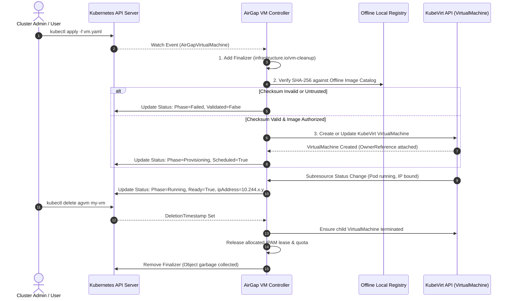
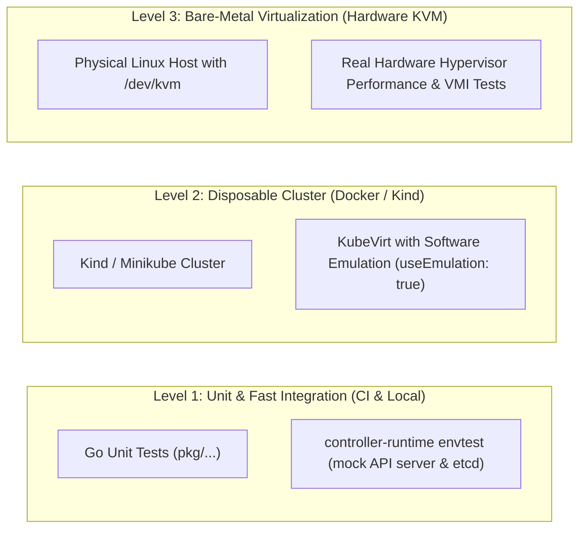

# Architecture Proposal: Real Kubernetes & KubeVirt Integration Path

> **Document Status:** Architectural Proposal (Design Phase)  
> **Target Version:** `gdc-vm-operator` v0.2.0-proposal  
> **Author:** Senior Infrastructure & Systems Engineering Review  
> **Security & Truthfulness Notice:** This project is an independent educational and architectural prototype demonstrating Kubernetes-inspired control-plane patterns for air-gapped infrastructure. It does not impersonate Google proprietary source code, claim affiliation with Google, or represent Google Distributed Cloud (GDC). Hypervisor workload execution is delegated to KubeVirt rather than implementing a custom bare-metal hypervisor.

---

## 1. Executive Summary & Architectural Comparison

The current implementation of `gdc-vm-operator` is a pure Go, standalone prototype that models Kubernetes control loops, CRD state machines, offline artifact verification, and deterministic IPAM without external cluster dependencies. To evolve this prototype toward genuine Kubernetes clusters, we evaluate three strategic architectural approaches:


### Comparative Analysis Matrix

| Evaluation Criteria | Option A: Standalone Simulator | Option B: Custom Hypervisor Controller | Option C: KubeVirt Integration Gateway (Recommended) |
| :--- | :--- | :--- | :--- |
| **Cluster Dependencies** | None (Zero k8s, zero root) | Full Kubernetes Cluster + Root Host Access | Standard Kubernetes Cluster + KubeVirt Operator |
| **Hypervisor Complexity** | Simulated child processes (`vm-runner`) | Extremely high (must manage libvirt, cgroups, vhost-net) | Delegated to KubeVirt (`virt-launcher` container pods) |
| **Air-Gap Security Policy** | Enforced in Go pre-flight admission | Enforced in controller | Enforced via Custom Resource + Validating Webhook |
| **Production Readiness** | Educational / Prototype only | High operational fragility and security risk | High (KubeVirt is CNCF graduated virtualization engine) |
| **Portability** | Cross-platform (Windows, Linux, macOS) | Linux bare-metal with `/dev/kvm` only | Any K8s cluster (supports software emulation in CI) |
| **Recommended Decision** | **Retain as learning/demo mode** | **Reject (unjustified complexity)** | **Adopt as real Kubernetes integration target** |

**Strategic Recommendation:**
1. **Retain Option A** as the default lightweight development and demonstration engine (`cmd/vmctl`, `pkg/reconciler`).
2. **Implement Option C** as an optional module (`controllers/kubevirt/`) using `sigs.k8s.io/controller-runtime` and `kubevirt.io/api`. The operator acts as an **Air-Gapped Virtualization Gateway**: validating cryptographic provenance and host limits, then declaring downstream KubeVirt `VirtualMachine` resources.

---

## 2. API Contract & Custom Resource Definition (CRD)

### Custom Resource: `AirGapVirtualMachine` (`v1alpha1`)
The API separates user intent (`Spec`) from observed runtime health (`Status`) with standard Kubernetes status subresources.

```yaml
apiVersion: apiextensions.k8s.io/v1
kind: CustomResourceDefinition
metadata:
  name: airgapvirtualmachines.infrastructure.io
spec:
  group: infrastructure.io
  names:
    kind: AirGapVirtualMachine
    listKind: AirGapVirtualMachineList
    plural: airgapvirtualmachines
    singular: airgapvirtualmachine
    shortNames:
      - agvm
  scope: Namespaced
  versions:
    - name: v1alpha1
      served: true
      storage: true
      subresources:
        status: {}
      schema:
        openAPIV3Schema:
          type: object
          required: [spec]
          properties:
            spec:
              type: object
              required: [resources, image]
              properties:
                resources:
                  type: object
                  required: [vcpu, memoryMb]
                  properties:
                    vcpu:
                      type: integer
                      minimum: 1
                      maximum: 128
                    memoryMb:
                      type: integer
                      minimum: 256
                      maximum: 1048576
                    diskGb:
                      type: integer
                      minimum: 1
                      maximum: 16384
                image:
                  type: object
                  required: [name, checksumSha256]
                  properties:
                    name:
                      type: string
                      pattern: '^[a-z0-9]([-a-z0-9]*[a-z0-9])?(\.[a-z0-9]([-a-z0-9]*[a-z0-9])?)*$'
                    checksumSha256:
                      type: string
                      pattern: '^[a-fA-F0-9]{64}$'
                    containerDiskUrl:
                      type: string
                      description: "Internal registry reference, e.g. registry.airgap.local/images/ubuntu:22.04"
                running:
                  type: boolean
                  default: true
                restartPolicy:
                  type: string
                  enum: [Always, OnFailure, Never]
                  default: Always
            status:
              type: object
              properties:
                phase:
                  type: string
                  enum: [Pending, Validating, Provisioning, Running, Degraded, Stopped, Failed, Terminating]
                kubeVirtVMName:
                  type: string
                ipAddress:
                  type: string
                observedGeneration:
                  type: integer
                conditions:
                  type: array
                  items:
                    type: object
                    required: [type, status, lastTransitionTime, reason, message]
                    properties:
                      type: { type: string }
                      status: { type: string, enum: ["True", "False", "Unknown"] }
                      lastTransitionTime: { type: string, format: date-time }
                      reason: { type: string }
                      message: { type: string }
```

---

## 3. Controller Architecture & Lifecycle Reconciliation



### 1. Reconciliation Idempotency & Optimistic Locking
- Uses standard Kubernetes controller loops with `controller-runtime` reconciler interface:
  `Reconcile(ctx context.Context, req ctrl.Request) (ctrl.Result, error)`
- Uses `client.Update` and `client.Status().Update` handling `apierrors.IsConflict(err)` with standard exponential backoff retries.
- Compares `metadata.generation` with `status.observedGeneration` to avoid duplicate reconciliation when only status conditions change.

### 2. Finalizers & Deletion Cleanup
- Invariant: A VM holding cluster resources or IP allocations must never be deleted without releasing its dependencies.
- Finalizer: `infrastructure.io/vm-cleanup`.
- If `DeletionTimestamp.IsZero()`: registers finalizer before taking action.
- If `!DeletionTimestamp.IsZero()`: executes cleanup sequence:
  1. Gracefully halts child KubeVirt VM workloads.
  2. Reclaims network IP address lease from local IPAM.
  3. Removes finalizer, allowing the API server to delete the resource.

### 3. Air-Gap Image Verification & Admission
- Verifies that the container disk URL resolves strictly to the internal offline registry (`registry.airgap.local` or cluster-local registry).
- Validates that the SHA-256 matches the cryptographic digest in the offline trust catalog before translating to KubeVirt `containerDisk` or CDI `DataVolume`.

---

## 4. Observability, Metrics & Telemetry

1. **Liveness & Readiness Probes:**
   - Dedicated health endpoints `/healthz` and `/readyz` served via `controller-runtime/pkg/healthz`.
2. **Prometheus Metrics (`/metrics`):**
   - `gdc_vm_reconcile_total`: Total reconciliation passes by phase and result.
   - `gdc_vm_reconcile_duration_seconds`: Histogram of reconciliation cycle latency.
   - `gdc_vm_active_count`: Gauge of active VMs by phase (`Running`, `Degraded`, `Failed`).
   - `gdc_vm_admission_rejections_total`: Counter of rejected air-gap violations.
3. **Structured Logging:**
   - Uses Go `log/slog` or `go-logr/logr` with contextual fields: `vm_name`, `namespace`, `phase`, `generation`.
4. **Kubernetes Events:**
   - Emits cluster events via `record.EventRecorder`: `Normal: Created`, `Normal: Started`, `Warning: ChecksumMismatch`, `Warning: CapacityExceeded`.

---

## 5. Least-Privilege Role-Based Access Control (RBAC)

The operator requires restricted permissions scoped strictly to its domain:

```yaml
apiVersion: rbac.authorization.k8s.io/v1
kind: ClusterRole
metadata:
  name: airgap-vm-operator-role
rules:
  # 1. Manage our own Custom Resource
  - apiGroups: ["infrastructure.io"]
    resources: ["airgapvirtualmachines"]
    verbs: ["get", "list", "watch", "create", "update", "patch", "delete"]
  - apiGroups: ["infrastructure.io"]
    resources: ["airgapvirtualmachines/status"]
    verbs: ["get", "update", "patch"]
  - apiGroups: ["infrastructure.io"]
    resources: ["airgapvirtualmachines/finalizers"]
    verbs: ["update"]

  # 2. Manage downstream KubeVirt VirtualMachines
  - apiGroups: ["kubevirt.io"]
    resources: ["virtualmachines", "virtualmachineinstances"]
    verbs: ["get", "list", "watch", "create", "update", "patch", "delete"]

  # 3. Emit Kubernetes Events
  - apiGroups: [""]
    resources: ["events"]
    verbs: ["create", "patch"]
```

---

## 6. Disconnected & Air-Gapped Deployment Strategy

For air-gapped environments without internet access:
1. **Container Image Bundles:**
   - Pre-packaged multi-arch container images (`airgap-vm-operator:v0.2.0`) exported via `docker save` or `skopeo copy`.
2. **Offline Registry Ingestion:**
   - Ingested via local offline bundle pipelines (such as `gdc-airgap-sync`) into the local internal image registry.
3. **Manifest Packaging:**
   - Single standalone manifest bundle `deploy/offline-install.yaml` and Helm chart with configurable offline image repository values:
     `image.repository: registry.local:5000/infrastructure/airgap-vm-operator`
     `image.pullPolicy: IfNotPresent`

---

## 7. Dependency & Version Compatibility Analysis

Based on current official Kubernetes and KubeVirt toolchain requirements (for Go 1.22+):

| Dependency | Target Version | Documentation Link | Compatibility Notes |
| :--- | :--- | :--- | :--- |
| **Go Toolchain** | `1.22.x` / `1.23.x` | [golang.org/doc/devel/release](https://go.dev/doc/devel/release) | Matches repository baseline |
| **Kubernetes API / Client-Go** | `v0.30.2` (k8s 1.30) | [github.com/kubernetes/client-go](https://github.com/kubernetes/client-go) | Compatible with Go 1.22+ |
| **Controller Runtime** | `v0.18.4` | [sigs.k8s.io/controller-runtime](https://github.com/kubernetes-sigs/controller-runtime) | Standard operator SDK foundation for K8s 1.29-1.31 |
| **KubeVirt API** | `v1.3.1` | [kubevirt.io/api](https://github.com/kubevirt/api) | Official KubeVirt CRD schema bindings |

---

## 8. Development & Integration Testing Strategy



### Test Classification Matrix

| Test Suite | Environment Requirements | Runs in GitHub Actions CI? | Hardware Virtualization Required? |
| :--- | :--- | :--- | :--- |
| **1. Unit & State Machine Tests** | Standard Go toolchain | **Yes** (Ubuntu & Windows runners) | **No** |
| **2. Controller EnvTest** | `etcd` + `kube-apiserver` binaries | **Yes** (via `setup-envtest`) | **No** |
| **3. KubeVirt Emulation Tests** | `kind` cluster + KubeVirt (`useEmulation: true`) | **Yes** (runs via QEMU TCG software emulation) | **No** |
| **4. Full KVM Workload Benchmarks** | Bare-metal Linux instance with `/dev/kvm` | Optional (Self-hosted hardware runner) | **Yes** (`/dev/kvm` required) |

---

## 9. Incremental Implementation Milestones & Rollback Strategy

1. **Milestone 1 (Specification Alignment):** Finalize CRD OpenAPI v3 schema and publish architecture documentation (this document).
2. **Milestone 2 (Decoupled Module):** Implement `controllers/kubevirt` in a separate subpackage without modifying `pkg/reconciler` or breaking the standalone `vmctl` CLI.
3. **Milestone 3 (EnvTest Suite):** Add integration tests using `sigs.k8s.io/controller-runtime/pkg/envtest` validating CRD creation, finalizer cleanup, and status updates.
4. **Milestone 4 (KubeVirt Gateway):** Translate verified `AirGapVirtualMachine` specs into child KubeVirt `VirtualMachine` objects in disposable `kind` clusters.

### Rollback Strategy
Because the KubeVirt integration is isolated in a separate controller package, the standalone file-based engine (`pkg/store`, `pkg/reconciler`, `cmd/vmctl`) remains fully independent. If KubeVirt cluster dependencies fail or are unavailable, users can immediately continue running in standalone simulation mode with zero breaking changes.
