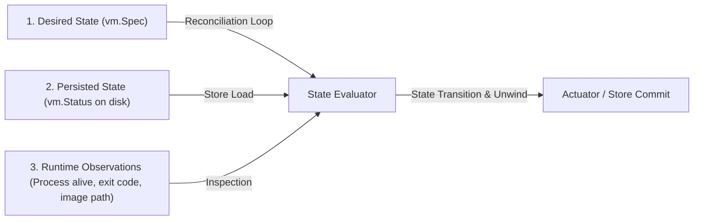
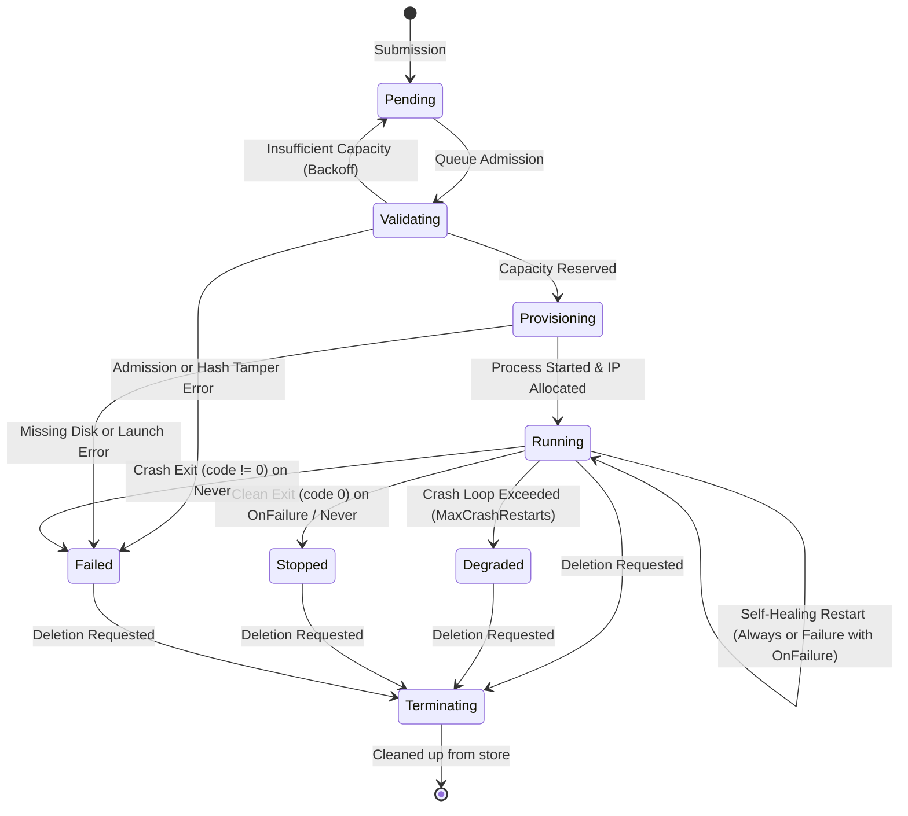

# GDC VM Operator - Resource Lifecycle & Restart-Safety Architecture

> **Document Version:** 1.0  
> **Status:** Standardized Architecture Specification  
> **Scope:** Lifecycle state transitions, resource reservation invariants, startup recovery, and restart policies for `gdc-vm-operator`.

---

## 1. Architectural Invariants

The control plane enforces the following strict invariants across all phases and transitions:

### Invariant 1: Single-Node Capacity Conservation
At any given moment, the total host node capacity allocated across all registered Virtual Machines must strictly satisfy:
$$\sum_{\text{vm} \in \mathcal{V}_{\text{active}}} \text{vCPU}(\text{vm}) \le \text{TotalVCPU}$$
$$\sum_{\text{vm} \in \mathcal{V}_{\text{active}}} \text{MemoryMB}(\text{vm}) \le \text{TotalMemoryMB}$$
$$\sum_{\text{vm} \in \mathcal{V}_{\text{active}}} \text{DiskGB}(\text{vm}) \le \text{TotalDiskGB}$$
where $\mathcal{V}_{\text{active}}$ consists of Virtual Machines in `Provisioning` or `Running` phases. Machines in `Pending`, `Validating`, `Stopped`, `Failed`, or `Terminating` states hold zero active reservations.

### Invariant 2: Deterministic IP Allocation & Collision Freedom
1. Every VM in `Running` phase holds exactly one valid host IP lease within the configured CIDR block (`10.244.0.0/24`).
2. Two distinct VMs cannot be allocated the same IP address at any point in time ($\forall v_1 \ne v_2 \implies \text{IP}(v_1) \ne \text{IP}(v_2)$).
3. Network broadcast and gateway addresses (`.0`, `.1`, `.255`) are strictly reserved and excluded from guest allocation.
4. When a VM enters a terminal phase (`Failed`, `Stopped`) or is deleted (`Terminating`), its IP address lease is immediately returned to the pool.

### Invariant 3: Idempotent Scheduler Reservations & Safe Spec Updates
1. Calling `Reserve(vm)` repeatedly with the same resource requirements is idempotent and returns success without incrementing allocations.
2. If `vm.Spec.Resources` is updated for an existing reservation, the scheduler atomically calculates the delta between the new and existing requirements.
3. If the host node cannot accommodate the new requirement, the update fails, and the previous valid reservation is preserved intact without loss of capacity.

### Invariant 4: Crash-Consistent State Reconstruction
When the controller starts or restarts:
1. It reads all persisted records from the state store before accepting reconciliation events.
2. For each active record (`Running`, `Provisioning`), it validates and reconstructs scheduler reservations and IP allocations.
3. Inconsistent records (e.g., conflicting IP assignments or host resource overcommit) are flagged with explicit error conditions (`IPConflictDetected`, `RecoveryCapacityExceeded`) and placed into `Degraded` or `Failed` status rather than silently overcommitting.

---

## 2. Reconciliation Boundary: Desired, Persisted, and Observed

The controller distinguishes three distinct state representations:

1. **Desired State (`Spec`):** Provided declaratively by the user or client. Includes compute hardware requirements (`VCPU`, `MemoryMB`, `DiskGB`), offline disk image name and checksum, network requirements, and `RestartPolicy`.
2. **Persisted State (`Status`):** The last durable state written to disk via `pkg/store`. Records `Phase`, `PID`, `AllocatedIP`, `RestartCount`, and condition history (`VMCondition`).
3. **Live Runtime Observation:** Transient facts discovered dynamically at reconciliation time:
   - Is the OS process with PID alive on the host?
   - If the process terminated, what was its exit code?
   - Does the local offline disk image artifact exist and match its hash?
   - Does the scheduler reservation match the current spec?
   - Is the IP allocated in IPAM?

---

## 3. State Machine & Transition Rules

### Transition Detail Table

| Current Phase | Event / Observation | Next Phase | Resource Action | Cleanup Semantics |
| :--- | :--- | :--- | :--- | :--- |
| `""` / `Pending` | Spec validation fails | `Failed` | Release all | Sets `Validated=False`. Unwinds any stray capacity or IP leases. |
| `Pending` | Capacity available | `Provisioning` | `scheduler.Reserve(vm)` | Atomically claims host compute capacity. |
| `Pending` | Insufficient node capacity | `Pending` | None | Stays queued. Sets `Scheduled=False, Reason=InsufficientCapacity`. |
| `Provisioning` | Runtime process start fails | `Failed` | Release all | Unwinds scheduler reservation and IPAM lease. Sets `AllocatedIP=""`, `PID=0`. |
| `Provisioning` | Process starts successfully | `Running` | Claim IP | Stores PID and allocated IP. Sets `Ready=True, NetworkReady=True`. |
| `Running` | Process alive | `Running` | None | No-op. Healthy heartbeat observed. |
| `Running` | Process dead, code != 0, `RestartPolicy: Always` | `Running` (or `Degraded`) | Preserve reservation | Increments `RestartCount`. Re-launches process if `< MaxCrashRestarts`. |
| `Running` | Process dead, code == 0, `RestartPolicy: OnFailure` | `Stopped` | Release all | Unwinds scheduler reservation and IPAM lease. Sets `Ready=False, Reason=Completed`. |
| `Running` | Process dead, code != 0, `RestartPolicy: OnFailure` | `Running` (or `Degraded`) | Preserve reservation | Self-heals if `< MaxCrashRestarts`. Sets `Degraded` if exceeded. |
| `Running` | Process dead, code == 0, `RestartPolicy: Never` | `Stopped` | Release all | Unwinds scheduler reservation and IPAM lease. Sets `Ready=False, Reason=Completed`. |
| `Running` | Process dead, code != 0, `RestartPolicy: Never` | `Failed` | Release all | Unwinds scheduler reservation and IPAM lease. Sets `Ready=False, Reason=CrashNonZeroExit`. |
| `*` | User requests deletion | `Terminating` | Release all | Stops runtime process, releases scheduler capacity, reclaims IP, deletes from disk store. |

---

## 4. Restart Policy Matrix

| Policy | Exit Code == 0 (Clean) | Exit Code != 0 (Crash / Fault) | Max Restarts Exceeded |
| :--- | :--- | :--- | :--- |
| **`Always`** | Restart process; increment `RestartCount` | Restart process; increment `RestartCount` | Transition to `Degraded` (`CrashLoopBackoff`) |
| **`OnFailure`** | Do NOT restart; transition to `Stopped`; unwind resources | Restart process; increment `RestartCount` | Transition to `Degraded` (`CrashLoopBackoff`) |
| **`Never`** | Do NOT restart; transition to `Stopped`; unwind resources | Do NOT restart; transition to `Failed`; unwind resources | N/A (zero restarts attempted) |

---

## 5. Failure Cleanup & Error Handling

1. **Failure during Admission:** When a manifest fails air-gap verification or resource limits, any reservations created during pre-flight are unwound immediately.
2. **Failure during Runtime Launch:** If the executable is missing, permissions fail, or disk image cannot be opened, the controller immediately unwinds both scheduler reservation and IP allocation.
3. **Controller Shutdown:** Controlled via context cancellation and synchronization primitives (`sync.WaitGroup`). Worker goroutines and queue timers are terminated cleanly without leaving orphaned timers or hanging process handles.
4. **Non-blocking Locks:** Locks on state stores, schedulers, and IPAM are held strictly for memory updates (tens of nanoseconds). Slow disk I/O (log writes, YAML encoding) and external process execution (`cmd.Start()`, `cmd.Wait()`) occur outside critical sections.

